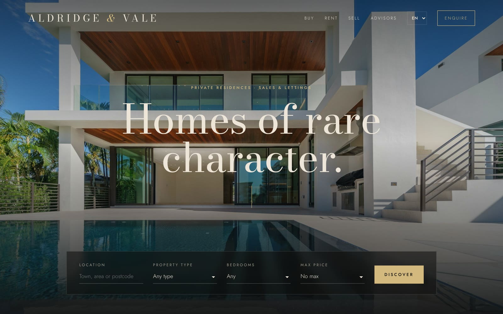
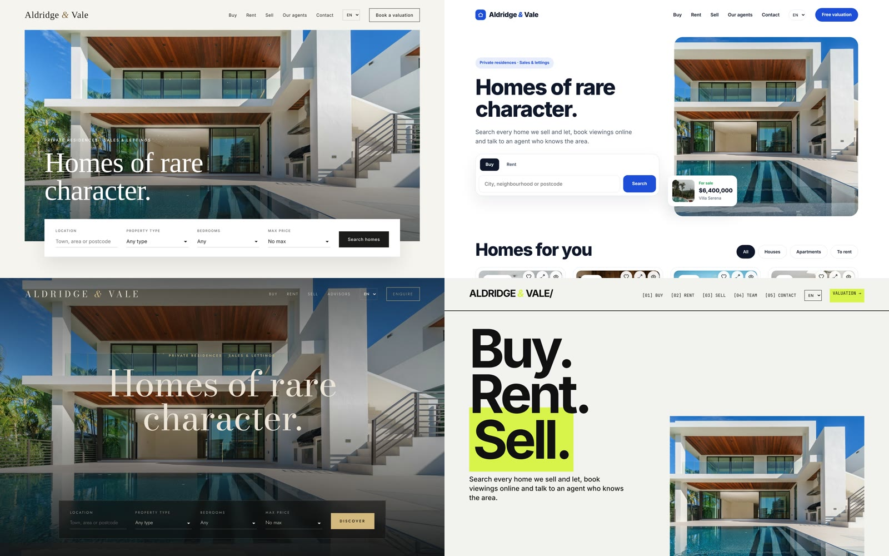
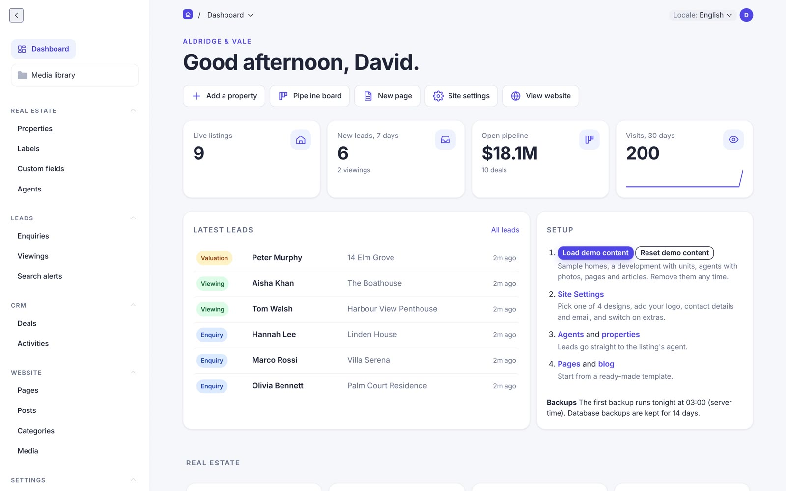
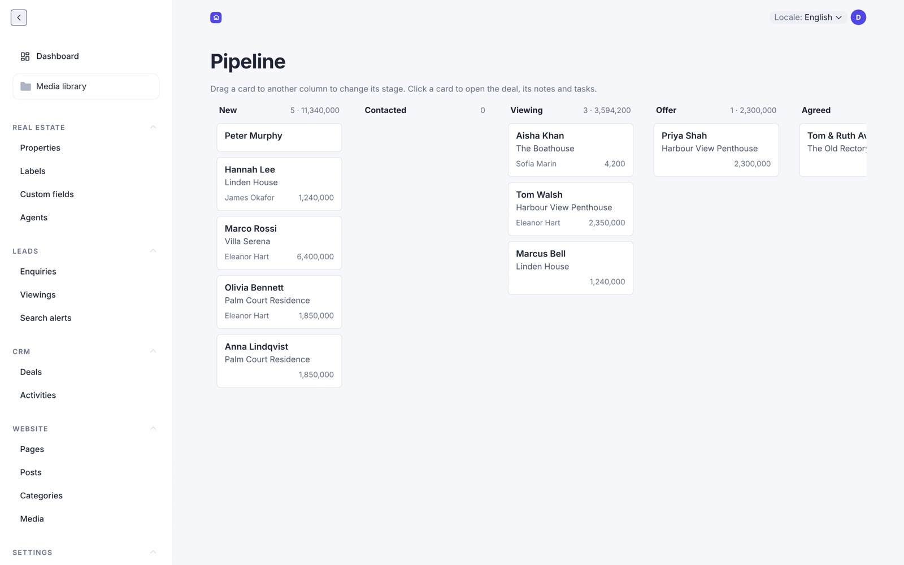

<p align="center">
  
</p>

<h1 align="center">Real Estate Website Kit</h1>

<p align="center">
  A complete, custom-built real estate website with its own admin, CRM and lead emails.<br>
  Free to use, modify and sell. No WordPress, no plugins, no monthly SaaS.
</p>

<p align="center">
  <a href="https://www.hostinger.com/docker-hosting?compose_url=https://raw.githubusercontent.com/mrwebtv/re-kit/main/docker-compose.yml"></a>
</p>

<p align="center">
  
  
  
  
  
  
</p>

---

## Four looks, one click to switch



Luxury editorial, Modern bright, Dark premium and Swiss bold. Change it in **Site Settings** and the whole site switches instantly.

## Deploy in one click

1. Click **Deploy on Hostinger** above, or get a VPS through **[mrweb.tv/hosting](https://mrweb.tv/hosting)** (KVM 2 is plenty) and choose **Ubuntu 24.04 with Docker**.
2. In hPanel open **Docker Manager > Compose from URL** and paste:
   `https://raw.githubusercontent.com/mrwebtv/re-kit/main/docker-compose.yml`
3. Optionally set `DOMAIN` (pointed at the VPS IP for automatic HTTPS), `POSTGRES_PASSWORD`, and the SMTP variables for lead emails. Then deploy.
4. Wait 3 to 5 minutes for the first build, open `https://yourdomain.com/admin` (or `http://VPS-IP/admin`) and create your admin user.

Secrets are generated automatically on first start and kept on the server. To update later, click **Update** in Docker Manager.

## An admin anyone in the office can run





## What's inside

- Properties, Agents, Enquiries (property, valuation, contact) and Viewings
- Every lead emails the property's agent, sends the visitor a confirmation and opens a deal in the built-in CRM (pipeline board, notes and tasks)
- 4 switchable designs, 4 admin themes, 8 languages (including right-to-left Arabic) and a currency switcher
- Search: radius and near me, price slider, multi-select filters, instant results, map, grid or list views, quick view, compare and favourites
- Listings: custom fields and labels, developments with units, documents, private notes, expiry dates, reference numbers, energy scale, nearby places, Walk Score, mortgage calculator, PDF brochure and print view
- Viewing booking from set time slots, agent profile pages, cookie-free visit analytics per listing and agent
- Page builder with ready-made templates (About, Sell your home, New development, Area guide, Splash page) and a blog
- MLS / IDX sync over the RESO Web API (Bridge, Trestle, Spark, MLS Grid), CSV and Kyero XML import, XML/JSON property feed
- Spam protection: honeypot, rate limiting, optional Cloudflare Turnstile or reCAPTCHA v3
- Postgres with PostGIS, media and database on persistent volumes, Caddy for HTTPS

## Local development

```bash
cp .env.example .env   # set DATABASE_URL to a local Postgres
pnpm install && pnpm dev
```

Open `http://localhost:3000/admin`, create your user, then click **Load demo content** on the dashboard.

## Make it yours

Add features with Claude: open the project, describe what you want ("add a mortgage calculator"), and review the change. Built by **[Mr Web](https://www.youtube.com/@mr_web)**.
